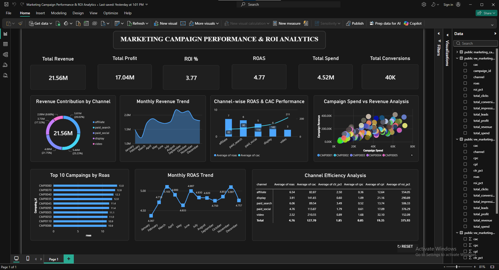

<h1 align="center">📊 Marketing Campaign Performance & ROI Analytics</h1>

<p align="center">
  
  
  
  
</p>

<p align="center">
  An end-to-end marketing analytics project covering campaign profitability, channel efficiency, customer acquisition cost, and ROI.
</p>

---

## 📌 Project Overview

This project analyzes multi-channel marketing campaign performance to evaluate advertising efficiency, campaign profitability, customer acquisition costs, and return on investment (ROI).

Using **Python, PostgreSQL, and Power BI**, raw marketing data is transformed into actionable business insights that help identify high-performing channels, evaluate campaign effectiveness, and support data-driven budget allocation decisions.

---

## 🖼️ Dashboard Preview



---

## 🎯 Business Objectives

- Evaluate marketing campaign profitability and ROI
- Compare performance across marketing channels
- Analyze the marketing funnel from impressions to conversions
- Identify campaigns with the highest ROAS
- Monitor monthly performance and trends
- Understand customer acquisition costs (CAC) across channels
- Provide data-driven recommendations for budget optimization

---

## 🛠️ Tools & Technologies

| Tool | Purpose |
|---|---|
| **Python (Pandas, NumPy)** | Data cleaning and exploratory analysis |
| **PostgreSQL** | Data storage, SQL analysis, and analytical views |
| **Power BI** | Interactive dashboard and business intelligence |
| **DAX** | KPI calculations and performance measures |
| **Jupyter Notebook** | Python-based analysis |

---

## 🗂️ Dataset Information

| Attribute | Details |
|---|---|
| **Total Records** | 11,240 |
| **Unique Campaigns** | 120 |
| **Marketing Channels** | 5 (Affiliate, Paid Search, Paid Social, Display, Video) |
| **Date Range** | January 2023 – December 2025 |

**Columns:** `spend_date`, `campaign_id`, `channel`, `impressions`, `clicks`, `leads`, `conversions`, `spend`, `revenue`, `month`

---

## ⚙️ Methodology

### 1. Data Cleaning (Python)
- Checked and handled missing values
- Identified and removed duplicate records
- Validated marketing funnel metrics
- Checked for negative spend and revenue values
- Converted date fields and prepared monthly data
- Exported the cleaned dataset for further analysis

### 2. SQL Analysis (PostgreSQL)
- Stored cleaned marketing data in PostgreSQL
- Performed aggregations and analytical queries
- Compared channel performance
- Analyzed monthly campaign performance
- Ranked campaigns by ROAS
- Created reusable analytical views

### 3. Power BI Dashboard
- Total Revenue, Profit, Marketing Spend, and Conversions
- ROI (%) and ROAS
- Revenue Contribution by Channel
- Monthly Revenue Trend
- Channel-wise ROAS & CAC Performance
- Top 10 Campaigns by ROAS
- Monthly ROAS Trend
- Channel Efficiency Analysis
- Campaign Spend vs Revenue Analysis
- Interactive filters and reset functionality

---

## 📈 Key Performance Indicators

| KPI | Result |
|---|---:|
| Total Marketing Spend | 4,523,050.02 |
| Total Revenue | 21,561,839.01 |
| Total Profit | 17,038,788.99 |
| Total Impressions | 436,844,819 |
| Total Clicks | 7,102,319 |
| Total Leads | 261,684 |
| Total Conversions | 39,696 |
| CTR | 1.63% |
| CPC | 0.64 |
| CPL | 17.28 |
| CAC | 113.94 |
| ROAS | 4.77x |
| ROI | 376.71% |
| Profit Margin | 79.02% |

### KPI Formulas

| Metric | Formula |
|---|---|
| CTR | Clicks ÷ Impressions |
| CPC | Spend ÷ Clicks |
| CPL | Spend ÷ Leads |
| CAC | Spend ÷ Conversions |
| ROAS | Revenue ÷ Spend |
| ROI | (Revenue − Spend) ÷ Spend × 100 |
| Profit Margin | (Revenue − Spend) ÷ Revenue × 100 |

---

## 🔍 Key Insights

### Channel Performance

| Channel | Highlights |
|---|---|
| **Affiliate** | Highest ROAS (6.54x) and lowest CAC (82.87) |
| **Paid Search** | Strong performance with 6.06x ROAS |
| **Paid Social** | 4.69M revenue with 4.76x ROAS |
| **Display** | Delivered 3.91x ROAS |
| **Video** | Lowest ROAS (2.52x) and highest CAC (210.55) |

### Top Campaign
**CMP0080** (Affiliate) was the best-performing campaign with a **13.01x ROAS** and a **CAC of 45.44**. Other high performers include **CMP0070** and **CMP0040**.

---

## 💡 Business Recommendations

1. **Increase budget** for Affiliate and Paid Search campaigns, given their strong ROAS and lower CAC.
2. **Review Video campaigns** to find ways to reduce acquisition costs.
3. **Investigate low-ROAS campaigns** before increasing their budgets.
4. **Monitor monthly ROAS and revenue trends** to detect performance shifts early.
5. **Optimize spend** using both profitability and conversion-efficiency metrics.

---

## 📁 Project Structure

```text
Marketing-Campaign-Performance-Analytics/
│
├── data/
│   ├── raw/
│   │   └── marketing-campaigns-v1.0.0-analysis.csv
│   └── processed/
│       └── marketing_campaign_cleaned.csv
│
├── notebooks/
│   └── marketing_campaign_analysis.ipynb
│
├── sql/
│   └── marketing_campaign_analysis.sql
│
├── powerbi/
│   ├── Marketing Campaign Performance & ROI Analytics.pbix
│   └── PowerBI Dashboard.png
│
└── README.md
```

---

## 🚀 How to Use

1. **Clone the repository**
   ```bash
   git clone https://github.com/SABBIR-HOSSAIN-001/marketing-campaign-performance-analytics.git
   ```
2. **Explore the analysis** – open `notebooks/marketing_campaign_analysis.ipynb` in Jupyter Notebook.
3. **Run the SQL queries** – load the cleaned CSV into PostgreSQL and run `sql/marketing_campaign_analysis.sql`.
4. **View the dashboard** – open the `.pbix` file in Power BI Desktop.

---

## ✅ Conclusion

This project demonstrates an end-to-end marketing analytics workflow, combining Python-based data preparation, PostgreSQL analysis, and Power BI visualization. It highlights differences in channel efficiency, campaign profitability, and acquisition costs, providing actionable insights for smarter marketing budget allocation.

---

**Project Focus:** Data Analytics | Business Intelligence | Marketing Analytics | ROI Analysis | Campaign Performance

## 👤 Author

**Sabbir Hossain**
🔗 [GitHub](https://github.com/SABBIR-HOSSAIN-001)
